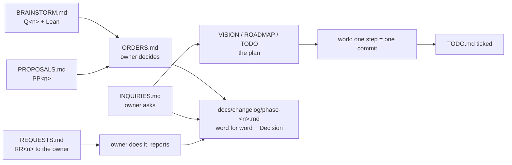

# devlog

The talk between the owner and the agents, and the plan it produces. The
standard look of a BOS project's `docs/devlog/`, the same as in the BOS core,
Amoorion and P_JOL_ROLL.

| File | What it holds | Who writes it |
| ---- | ------------- | ------------- |
| `VISION.md` | why the project exists, its principles, the idea of each phase | agents, from the owner's words |
| `ROADMAP.md` | milestones and phases on the version scale | agents, from the owner's words |
| `TODO.md` | the checklist: `## Phase <n>: <title>`, then `- [ ]` / `- [x]` items | agents tick items in the commit that finishes them |
| `BRAINSTORM.md` | open questions `## Q<n>. <title>`, each with a *Lean:* | agents ask, the owner decides |
| `PROPOSALS.md` | ideas for debate `PP<n>` | anyone proposes, the owner decides in ORDERS.md |
| `ORDERS.md` | the owner's decisions: answers to `Q<n>` and to `PP<n>`, below its `---` | **owner**; agents empty it |
| `INQUIRIES.md` | the owner's requests in their own words, below its `---` | **owner**; agents empty it |
| `REQUESTS.md` | requirement requests `RR<n>`: work on the owner's side the agents need, each with *Why:* and *How:*; the owner reports below its `---` | agents ask, the owner reports; agents empty it |
| `STATE.md` | where the project stands; made by `task devlog:state` (the `bos` command of the core), not kept in git | the core |
| `Taskfile.yml` | `scrapnote`, `state` | agents |
| `scrapnote-<UNIXUSAT>.md` | notes of a working round, not sorted yet | anyone |
| `AGENTS.md` | imports this README for agents | |

## How a batch moves

1. The owner answers questions and decides proposals below `---` in ORDERS.md
   and asks below `---` in INQUIRIES.md (or in the chat; the words are then
   copied from there).
2. An agent first turns an inquiry into the plan (VISION, ROADMAP, TODO).
3. The owner's words move **word for word** into the append-only
   `docs/changelog/phase-<n>.md`, answered questions and decided proposals
   with their **Decision:**; ORDERS.md and INQUIRIES.md go back to their
   header, the answered `Q<n>` leave BRAINSTORM.md, the decided `PP<n>`
   PROPOSALS.md.
4. Then the work, one step per commit on the agent's `dev/<name>`, each
   ticking its TODO item.
5. What only the owner can do (a repository setting, a check in a real
   browser, an account, a decision outside the code) is asked as a
   requirement request `RR<n>` in REQUESTS.md, never left in a report
   alone. The owner's report on it moves word for word into the changelog
   as `### RR<n>`, and the request leaves the file.

Numbers `Q<n>`, `PP<n>` and `RR<n>` are given once and never reused. A question never
gets settled in code before the owner answers it. Agents' own findings go to
`docs/.agents/`, not here.
